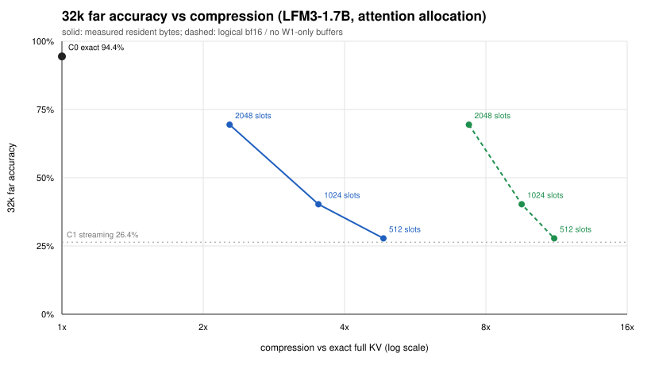

# Compression vs 32k far accuracy

Measured resident bytes at 32k; logical assumes a bf16 memory slot is the only copy and
the W1-only anchor/replay buffers are removed. The global-attention ratio is the
sink+slots+window cache alone, not the resident footprint.

| slots | far C1 | far C3 | resident | no W1 buffers | bf16 core | logical | global attn | C3 MiB |
|-------|--------|--------|----------|---------------|-----------|---------|-------------|--------|
| 512 | 26.4% | 27.8% | 4.84x | 8.33x | 9.56x | 11.19x | 12.19x | 45.5 |
| 1024 | 26.4% | 40.3% | 3.52x | 6.00x | 7.38x | 9.53x | 10.24x | 69.5 |
| 2048 | 26.4% | 69.4% | 2.28x | 3.85x | 5.06x | 7.36x | 7.76x | 117.6 |

The measured frontier is the solid line: more compression at 512 costs far accuracy;
the 2048 point buys 69.4% far accuracy at 2.28x resident. The 8x design target is only
the global-attention/logical projection; the resident implementation pays for the fp32
memory duplicate, the anchor refs, and the replay buffer. Cutting W1 removes the
last two; a bf16 memory and a direct associative read (no duplicated slot cache)
close the remaining gap.

